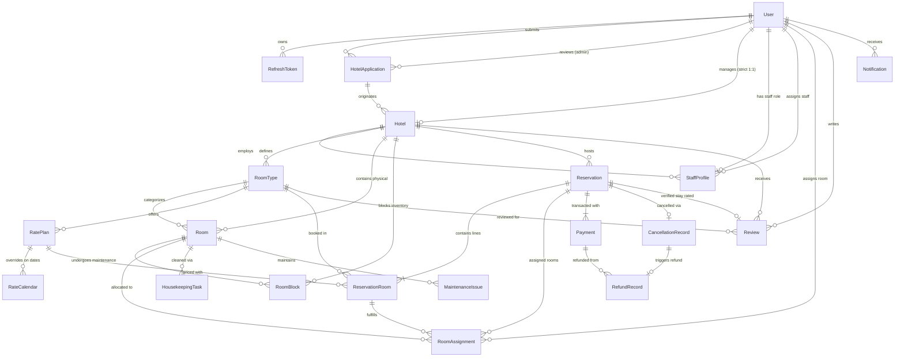

# Voyage Hotel Booking & Management System (HBMS) — Entity-Relationship (ER) Diagram & Schema Specification

This document details the complete database architecture, entity relationships, constraints, and custom indexing strategy implemented in MongoDB Atlas via Prisma ORM.

---

## 1. High-Level Entity-Relationship (ER) Diagram

---

## 2. Core Entities & Schema Definitions

### 2.1 Identity, Authentication & Profiles

#### `User`
Primary principal entity for all system users across roles.
- `id` (ObjectId, PK): Unique user identifier.
- `email` (String, Unique): Case-insensitive email address.
- `password_hash` (String): Salted bcrypt password hash.
- `role` (Enum): `GUEST` | `RECEPTIONIST` | `HOUSEKEEPING` | `HOTEL_MANAGER` | `PLATFORM_ADMIN`.
- `first_name` (String), `last_name` (String), `phone` (String, Optional).
- `status` (Enum): `ACTIVE` | `SUSPENDED`.
- `created_at` (DateTime), `updated_at` (DateTime).

#### `RefreshToken`
Secure refresh token storage with cryptographically hashed tokens and auto-expiration.
- `id` (ObjectId, PK): Unique token record ID.
- `user_id` (ObjectId, FK -> `User.id`, Cascade): Owner user.
- `token_hash` (String, Unique): SHA-256 hashed refresh token string.
- `ip_address` (String, Optional), `user_agent` (String, Optional).
- `is_revoked` (Boolean): Explicit revocation flag.
- `expires_at` (DateTime): MongoDB TTL indexed expiration date.

#### `StaffProfile`
Hotel-scoped operational permissions and staff role assignments.
- `id` (ObjectId, PK): Unique profile record ID.
- `user_id` (ObjectId, FK -> `User.id`, Unique, Cascade): Associated staff user.
- `hotel_id` (ObjectId, FK -> `Hotel.id`, Cascade): Scoped property.
- `role` (Enum): Assigned operational role (`RECEPTIONIST` | `HOUSEKEEPING`).
- `assigned_by_id` (ObjectId, FK -> `User.id`, Optional): Manager who assigned role.
- `is_active` (Boolean): Active employment toggle.

---

### 2.2 Onboarding & Property Core

#### `HotelApplication`
Self-serve partner hotel registration submitted by prospective managers for Admin approval.
- `id` (ObjectId, PK): Application identifier.
- `applicant_user_id` (ObjectId, FK -> `User.id`): Submitting prospective manager.
- `hotel_name` (String), `business_registration_number` (String), `tax_id` (String).
- `contact_email` (String), `contact_phone` (String), `address` (String), `city` (String), `state` (String), `country` (String), `postal_code` (String).
- `latitude` (Float), `longitude` (Float).
- `category` (Enum): `LUXURY` | `BOUTIQUE` | `BUSINESS` | `RESORT` | `BUDGET`.
- `status` (Enum): `PENDING` | `UNDER_REVIEW` | `APPROVED` | `REJECTED` | `RESUBMISSION_REQUESTED`.
- `admin_notes` (String, Optional), `rejection_reason` (String, Optional).
- `reviewed_by_id` (ObjectId, FK -> `User.id`, Optional), `reviewed_at` (DateTime, Optional).

#### `Hotel`
Authoritative property catalog entity powering the 3D globe and guest search.
- `id` (ObjectId, PK): Unique property ID.
- `application_id` (ObjectId, FK -> `HotelApplication.id`, Optional): Sourcing application.
- `manager_id` (ObjectId, FK -> `User.id`, Unique): Strictly enforced 1:1 Designated Manager.
- `name` (String), `slug` (String, Unique): URL-safe kebab-case slug.
- `description` (String, Optional).
- `category` (Enum): `LUXURY` | `BOUTIQUE` | `BUSINESS` | `RESORT` | `BUDGET`.
- `star_rating` (Int, 1–5).
- `location` (Embedded `GeoJsonPoint`): `{ type: "Point", coordinates: [lng, lat] }` for MongoDB 2dsphere spatial queries.
- `latitude` (Float), `longitude` (Float).
- `address` (String), `city` (String), `state` (String), `country` (String), `postal_code` (String).
- `phone` (String), `email` (String).
- `images` (String[]): Array of high-resolution asset URLs.
- `currency` (String): ISO 4217 code (default `"INR"`).
- `check_in_time` (String, default `"14:00"`), `check_out_time` (String, default `"11:00"`).
- `tax_rate_bps` (Int): Property tax in basis points (e.g. 1200 = 12%).
- `status` (Enum): `ACTIVE` | `SUSPENDED`.

---

### 2.3 Inventory, Physical Rooms & Pricing

#### `RoomType`
Logical category of accommodations possessing distinct layouts, capacity, and amenities.
- `id` (ObjectId, PK): Unique room type ID.
- `hotel_id` (ObjectId, FK -> `Hotel.id`, Cascade).
- `name` (String), `slug` (String).
- `description` (String, Optional).
- `max_guests` (Int), `max_adults` (Int), `max_children` (Int).
- `bed_type` (String), `room_size_sqm` (Float, Optional).
- `amenities` (String[]), `images` (String[]).
- `is_active` (Boolean).
- `version` (Int): Optimistic Concurrency Control (OCC) counter for inventory mutations.
- **Unique Constraint:** Compound unique `[hotel_id, name]`.

#### `Room`
Physical room units located on specific hotel floors.
- `id` (ObjectId, PK): Unique physical room ID.
- `hotel_id` (ObjectId, FK -> `Hotel.id`, Cascade).
- `room_type_id` (ObjectId, FK -> `RoomType.id`, Cascade).
- `room_number` (String): Physical door number (e.g. `"201"`, `"3402"`).
- `floor` (Int).
- `operational_status` (Enum): `READY` | `OCCUPIED` | `DIRTY` | `CLEANING` | `INSPECTION` | `MAINTENANCE`.
- `is_active` (Boolean).
- `version` (Int): OCC counter for assignment concurrency.
- **Unique Constraint:** Compound unique `[hotel_id, room_number]`.

#### `RoomBlock`
Maintenance or administrative out-of-order blocks that decrement available room capacity for a date range.
- `id` (ObjectId, PK): Unique block ID.
- `hotel_id` (ObjectId, FK -> `Hotel.id`, Cascade).
- `room_id` (ObjectId, FK -> `Room.id`, Cascade).
- `start_date` (DateTime), `end_date` (DateTime).
- `reason` (String).
- `created_by_id` (ObjectId, Optional).

#### `RatePlan` & `RateCalendar`
Dynamic pricing engine supporting base rates, packages, and date-specific calendar overrides.
- `RatePlan.id` (ObjectId, PK).
- `RatePlan.room_type_id` (ObjectId, FK -> `RoomType.id`, Cascade).
- `RatePlan.name` (String), `description` (String, Optional).
- `RatePlan.base_price_cents` (Int): Base price in integer paise/cents.
- `RatePlan.cancellation_policy` (Enum): `FREE_CANCELLATION` | `PARTIAL_REFUND` | `NON_REFUNDABLE`.
- `RatePlan.cancellation_deadline_hours` (Int): Minimum notice for penalty-free cancellation.
- `RatePlan.is_default` (Boolean).
- `RateCalendar.id` (ObjectId, PK).
- `RateCalendar.rate_plan_id` (ObjectId, FK -> `RatePlan.id`, Cascade).
- `RateCalendar.date` (DateTime).
- `RateCalendar.price_override_cents` (Int, Optional).
- `RateCalendar.is_available` (Boolean, default `true`).
- **Unique Constraint:** Compound unique `[rate_plan_id, date]`.

---

### 2.4 Reservations, Allocations & Financials

#### `Reservation`
Authoritative booking record tracking lifecycle, atomic hold expiration, and financial breakdown.
- `id` (ObjectId, PK): Unique reservation ID.
- `reservation_code` (String, Unique): Human-readable alphanumeric booking code (e.g. `"RES-REV-PARIS-101"`).
- `idempotency_key` (String, Optional): Target-fingerprinted key for anti-duplicate protection.
- `hotel_id` (ObjectId, FK -> `Hotel.id`).
- `guest_user_id` (ObjectId, FK -> `User.id`, Optional): Registered guest account.
- `guest_name` (String), `guest_email` (String), `guest_phone` (String).
- `check_in_date` (DateTime), `check_out_date` (DateTime).
- `total_rooms_count` (Int).
- `status` (Enum): `TEMPORARY_HOLD` | `CONFIRMED` | `CHECKED_IN` | `CHECKED_OUT` | `CANCELLED` | `EXPIRED`.
- `hold_expires_at` (DateTime, Optional): 15-minute lock expiration timestamp.
- `subtotal_cents` (Int), `tax_cents` (Int), `fees_cents` (Int), `total_cents` (Int).
- `currency` (String): Currency code inherited from property.
- `is_walk_in` (Boolean, default `false`).

#### `ReservationRoom`
Line-item booking breakdown specifying room types, rate plans, and nightly snapshot rates.
- `id` (ObjectId, PK): Unique line ID.
- `reservation_id` (ObjectId, FK -> `Reservation.id`, Cascade).
- `room_type_id` (ObjectId, FK -> `RoomType.id`).
- `rate_plan_id` (ObjectId, FK -> `RatePlan.id`).
- `quantity` (Int): Number of rooms booked under this type.
- `nightly_rate_cents` (Int), `total_price_cents` (Int).
- `nightly_breakdown` (Embedded `NightlyRateSnapshot[]`): Array of `{ date, rate_cents, is_override }`.

#### `RoomAssignment`
Physical key/room allocation binding a reserved room type slot to a specific physical room door.
- `id` (ObjectId, PK): Unique assignment ID.
- `reservation_id` (ObjectId, FK -> `Reservation.id`, Cascade).
- `reservation_room_id` (ObjectId, FK -> `ReservationRoom.id`, Cascade).
- `slot_index` (Int): Stable slot index `[0 .. quantity - 1]`.
- `room_id` (ObjectId, FK -> `Room.id`): Physical door assigned.
- `assigned_by_id` (ObjectId, FK -> `User.id`, Optional): Front desk agent.
- `assigned_at` (DateTime).
- `status` (Enum): `ACTIVE` | `RELEASED` | `CANCELLED`.
- `released_at` (DateTime, Optional), `release_reason` (String, Optional).

#### `Payment` & `RefundRecord`
Authoritative ledger tracking guest transactions, mock gateway references, and refund disbursements.
- `Payment.id` (ObjectId, PK).
- `Payment.reservation_id` (ObjectId, FK -> `Reservation.id`, Cascade).
- `Payment.idempotency_key` (String, Unique).
- `Payment.transaction_reference` (String, Unique): e.g. `"TXN-20261113-ABCD"`.
- `Payment.payment_provider` (String, default `"MOCK_PROVIDER"`).
- `Payment.amount_cents` (Int), `currency` (String).
- `Payment.status` (Enum): `PENDING` | `SUCCESS` | `FAILED` | `REFUNDED`.
- `RefundRecord.id` (ObjectId, PK).
- `RefundRecord.cancellation_id` (ObjectId, FK -> `CancellationRecord.id`, Unique, Cascade).
- `RefundRecord.payment_id` (ObjectId, FK -> `Payment.id`).
- `RefundRecord.refund_reference` (String, Unique): e.g. `"REF-20261113-EF12"`.
- `RefundRecord.amount_cents` (Int), `currency` (String).
- `RefundRecord.status` (Enum): `PENDING` | `PROCESSED` | `FAILED`.

---

### 2.5 Operations, Housekeeping & Reviews

#### `HousekeepingTask`
Operational task tracking room cleaning, turnover sanitization, and supervisor inspection.
- `id` (ObjectId, PK): Task ID.
- `hotel_id` (ObjectId, FK -> `Hotel.id`), `room_id` (ObjectId, FK -> `Room.id`).
- `assigned_to_id` (ObjectId, Optional): Housekeeping staff user ID.
- `inspected_by_id` (ObjectId, Optional): Supervisor/Receptionist ID.
- `task_type` (Enum): `TURNOVER_CLEAN` | `DAILY_STAY_CLEAN` | `DEEP_CLEAN` | `INSPECTION`.
- `status` (Enum): `PENDING` | `IN_PROGRESS` | `AWAITING_INSPECTION` | `COMPLETED`.
- `started_at` (DateTime, Optional), `completed_at` (DateTime, Optional).

#### `Review`
Verified guest stay review and rating module.
- `id` (ObjectId, PK): Review ID.
- `hotel_id` (ObjectId, FK -> `Hotel.id`, Cascade).
- `reservation_id` (ObjectId, FK -> `Reservation.id`, Unique): Strictly enforced 1:1 reservation binding (guests can rate only once per stay).
- `room_type_id` (ObjectId, FK -> `RoomType.id`, Optional): Specific room type stayed in (displayed on hotel review card).
- `user_id` (ObjectId, FK -> `User.id`, Cascade): Author guest ID.
- `rating` (Int, 1–5): Star rating.
- `title` (String, Optional), `comment` (String).
- `stay_date` (String, Optional): Operational stay period (e.g. `"November 2026"`).
- `is_verified` (Boolean, default `true`).

---

## 3. MongoDB Custom Indexing Strategy

In addition to Prisma-managed unique constraints, the following canonical MongoDB native indexes are reconciled during database seeding:

| Collection | Index Name | Index Key Specification | Constraints / Flags | Purpose |
|---|---|---|---|---|
| `Hotel` | `hotel_location_2dsphere` | `{ location: "2dsphere" }` | Geospatial | Powers `$nearSphere` and `$geoWithin` queries for radius & bounding box hotel searches |
| `Hotel` | `hotel_application_id_partial_unique` | `{ application_id: 1 }` | Unique (`partialFilterExpression: { application_id: { $type: "objectId" } }`) | Guarantees an application cannot be approved to multiple hotels while allowing null applications |
| `Reservation` | `reservation_idempotency_key_partial_unique` | `{ idempotency_key: 1 }` | Unique (`partialFilterExpression: { idempotency_key: { $type: "string" } }`) | Eliminates duplicate concurrent payments or confirmations |
| `RoomAssignment` | `room_assignment_active_slot_unique` | `{ reservation_room_id: 1, slot_index: 1 }` | Unique (`partialFilterExpression: { status: "ACTIVE" }`) | Ensures no reserved slot index is double-assigned to multiple rooms |
| `RefreshToken` | `refresh_token_ttl_idx` | `{ expires_at: 1 }` | TTL (`expireAfterSeconds: 0`) | Native MongoDB automatic background purge of expired JWT refresh sessions |

